<p align="center">
  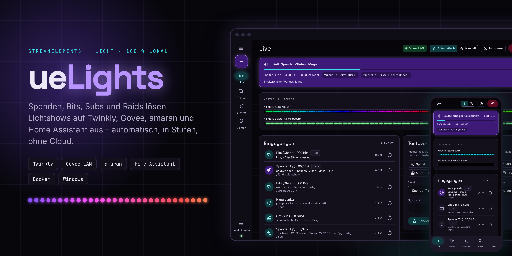
</p>

<p align="center">
  <a href="https://github.com/Intracy/ueLights/actions/workflows/ci.yml"></a>
  
  
  <a href="https://github.com/Intracy/ueLights/releases/latest"></a>
  
  <a href="LICENSE"></a>
</p>

<p align="center">
  <b>Spenden, Bits, Subs, Raids und Kanalpunkte aus StreamElements lösen echte Lichtshows aus –<br>
  auf Twinkly, Govee, amaran, Philips Hue und allem, was in Home Assistant hängt. Automatisch, in Stufen, ohne Cloud.</b>
</p>

<p align="center">
  <a href="#-schnellstart">Schnellstart</a> ·
  <a href="#-funktionen">Funktionen</a> ·
  <a href="#-screenshots">Screenshots</a> ·
  <a href="#-lichter-einrichten">Lichter einrichten</a> ·
  <a href="#-so-funktioniert-es">Architektur</a> ·
  <a href="#-roadmap">Roadmap</a>
</p>

---

## ✨ Auf einen Blick

<p align="center">
  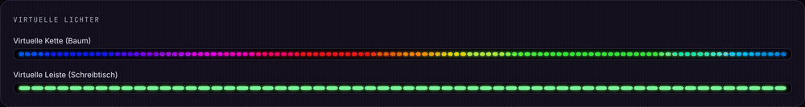
</p>

- **5 € → Puls, 10 € → Party, ab 50 € → alles:** Betragsstufen für Spenden, Bits, Gift-Subs und Raids, jede mit eigener Lichtshow.
- **Mehrere Hersteller in einem Alert:** Twinkly-Effekt, Govee-Szene und amaran-Blitz zeitversetzt auf einer gemeinsamen Zeitleiste.
- **Fertige Effekte aus den Hersteller-Apps:** Twinkly-Movies, Govee-App-Szenen, amaran-Effekte und Home-Assistant-Szenen direkt auswählbar, ohne sie nachzubauen.
- **Komplett lokal:** Die einzige Verbindung nach außen ist der WebSocket zu StreamElements, und den baut ueLights selbst auf. Keine Hersteller-Cloud, keine API-Keys, keine Portfreigabe.
- **Automatisch oder auf Freigabe:** Standardmäßig lösen eingehende Alerts sofort aus. Auf Knopfdruck warten sie im Live-Feed auf dein OK.
- **Sicher im Stream:** Flacker-Schutz, Sperre für Bildlicht, Pause, Ruhezeiten und ein großer **Alles stoppen**-Knopf.

## 🚀 Schnellstart

<table>
<tr>
<td width="33%" valign="top">

**🐳 Docker / Synology NAS**

```bash
git clone https://github.com/Intracy/ueLights.git
cd ueLights
docker compose up -d --build
```

→ `http://<NAS-IP>:8787`

Synology ohne SSH: eine Aufgabe im **Aufgabenplaner** installiert und aktualisiert alles selbst ([Anleitung](#synology-aufgabenplaner)).

</td>
<td width="33%" valign="top">

**🪟 Windows: eine Datei**

1. **[`ueLights.exe` herunterladen](https://github.com/Intracy/ueLights/releases/latest/download/ueLights.exe)**
2. Doppelklicken, fertig

Node.js ist eingebaut, eine Installation ist nicht nötig. Der Browser öffnet sich automatisch. Alternativ: `ueLights-starten.bat` aus dem Repo.

**🍎 Mac:** Repo laden, `ueLights-starten.command` doppelklicken.

</td>
<td width="33%" valign="top">

**🧪 Ausprobieren ohne Hardware**

```bash
npm install
npm run build
npm run demo
```

→ `http://localhost:8787` mit Demo-Lichtern, -Alerts und virtuellen LED-Streifen.

</td>
</tr>
</table>

Beim ersten Öffnen legst du ein Passwort fest. Danach in **Einstellungen → StreamElements** das JWT-Token eintragen (Dashboard → Avatar → Kanal → *Show secrets*) und unter **Lichter** die Geräte hinzufügen.

## 🧩 Funktionen

| | |
| --- | --- |
| **⚡ Auslösung** | **Automatisch** (Standard): Eingehende StreamElements-Events lösen sofort aus. **Manuell**: Alerts warten im Live-Feed auf *Freigeben* oder *Verwerfen*. Umschalter oben rechts, pro Alert übersteuerbar. |
| **🎯 Trigger** | Spende (Tip), Bits, Sub/Resub, Gift-Subs (Gift-Bomben werden gebündelt), Raid, Follow, Kanalpunkte, Chat-Nachrichten und -Befehle, Superchat, Merch, Hype-Train |
| **🪜 Bedingungen & Stufen** | Betrag *genau / von–bis / ab*, beliebig viele Stufen mit Prüfung auf Lücken und Überschneidungen, Text in der Nachricht, Kanalpunkte-Belohnung, Plattform, Sub-Stufe, Testevents an/aus. Ein exakter Betrag (z. B. 13,37 €) schlägt jeden Bereich. |
| **🎬 Alert-Builder** | Beliebig viele Alerts. Pro Alert bzw. Stufe beliebig viele **Licht-Spuren** (Licht oder Gruppe + Effekt + Start + Dauer) auf einer Zeitleiste. Priorität per Reihenfolge, Cooldown, „zusätzlich ausführen“. |
| **🌈 Eigene Effekte** | Statisch, Puls, Strobe, Farbwechsel, Regenbogen, Lauflicht, Füllstand, Überblenden, mit Live-Vorschau im Browser. Derselbe Renderer läuft auf dem Server, die Vorschau entspricht also genau dem, was die Lichter zeigen. |
| **🏭 Hersteller-Effekte** | Twinkly-Movies, Playlists und eingebaute Effekte · Govee-App-Szenen (lokal per `ptReal`) · amaran-Effekte, Presets, Quickshots und Szenen · Hue-Szenen (auch dynamisch) und Lampen-Effekte wie Kerze und Kaminfeuer · Home-Assistant-Effekte, Szenen und Skripte |
| **💶 Betrag als Parameter** | Helligkeit, Füllstand oder Dauer wachsen mit der Höhe der Spende oder der Bits |
| **🎨 Farbe aus dem Chat** | Kanalpunkte „Farbe wählen: blau“ oder `!farbe #ff00ff` färben die Lichter (Farbwörter auf Deutsch/Englisch und Hex) |
| **💡 Lichter** | Twinkly (Echtzeit pro LED), Govee LAN, amaran Desktop, Philips Hue (Lampen, Räume, Zonen), Home Assistant, Webhook, **virtuelle Lichter** zum Testen. Gerätesuche im Netz, Gruppen über Hersteller hinweg, Ruhezustand je Licht (wie vorher / aus / Farbe / Hersteller-Effekt). |
| **🛡️ Sicherheit** | Flacker-Schutz (Standard: max. 3 Blitze/s), Bildlicht-Sperre, Ruhezeiten, Pause, Alles stoppen, Verwerfen alter Events nach einem Reconnect, Limit für die Warteschlange, Login mit Passwort |
| **📡 Live** | Feed mit Status je Event, Anzeige „läuft gerade“ mit Fortschritt, Warteschlange, erneut abspielen, Testevents mit einem Klick, virtuelle LED-Streifen |
| **🧰 Betrieb** | Docker/Compose mit Synology-Auto-Update (Aufgabenplaner, Rollback), Windows- und Mac-Skripte mit Autostart und Update, PWA fürs iPad/iPhone, Backup/Import als JSON (ohne Geheimnisse), CI mit Tests |

## 📸 Screenshots

### Live: was gerade passiert

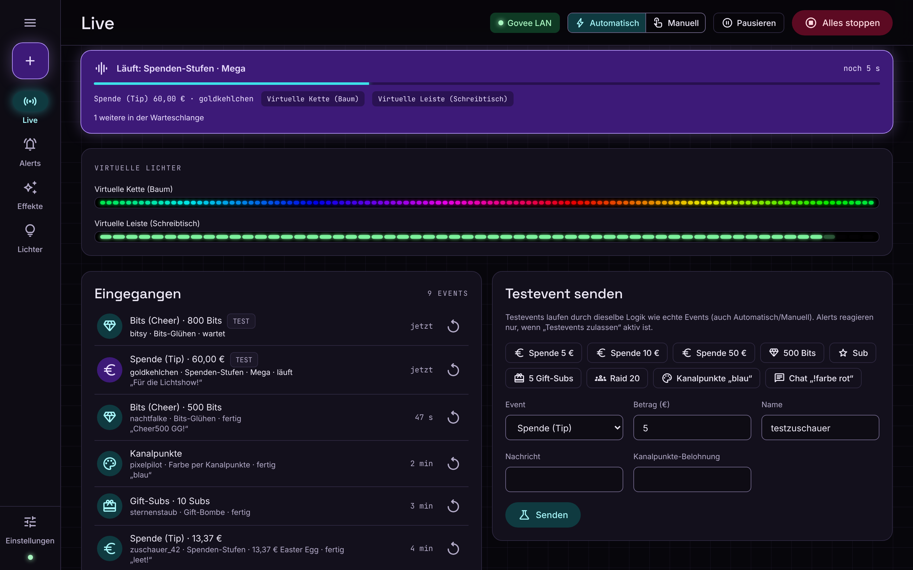

### Alert-Builder: Stufen und Licht-Spuren

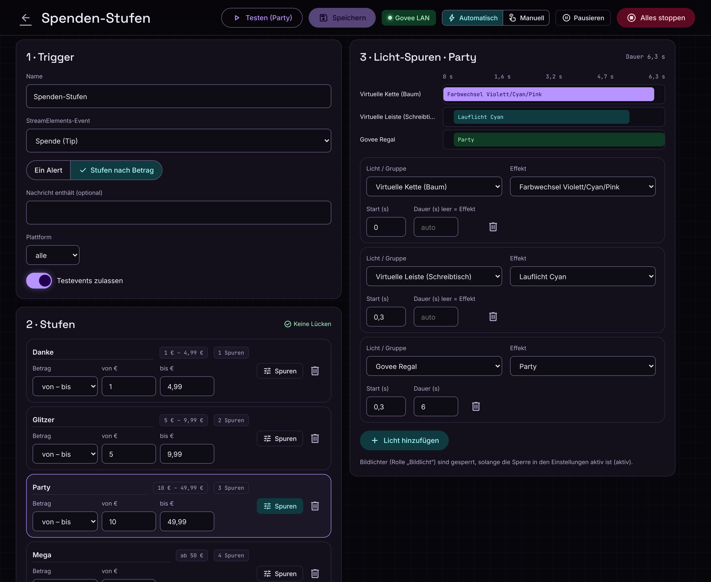

<table>
<tr>
<td width="50%"><b>Alerts</b><br>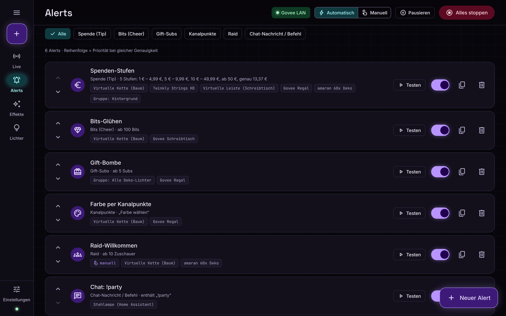</td>
<td width="50%"><b>Manueller Modus: Freigabe</b><br>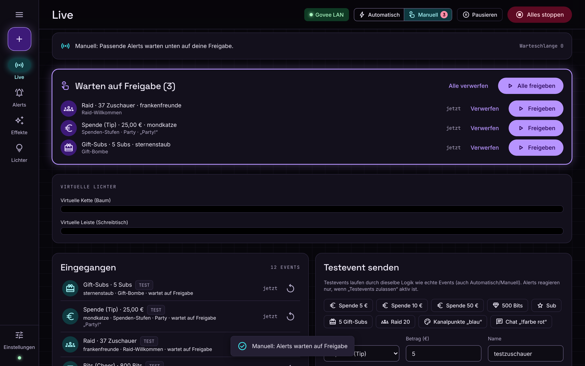</td>
</tr>
<tr>
<td><b>Eigene Effekte mit Live-Vorschau</b><br>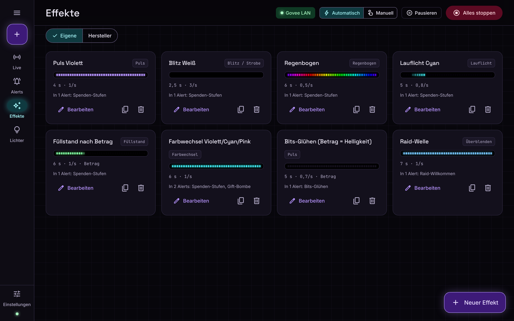</td>
<td><b>Effekt-Editor (Betrag als Parameter)</b><br>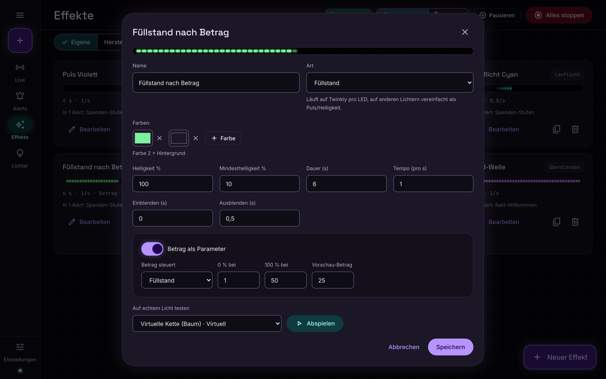</td>
</tr>
<tr>
<td><b>Hersteller-Effekte</b><br>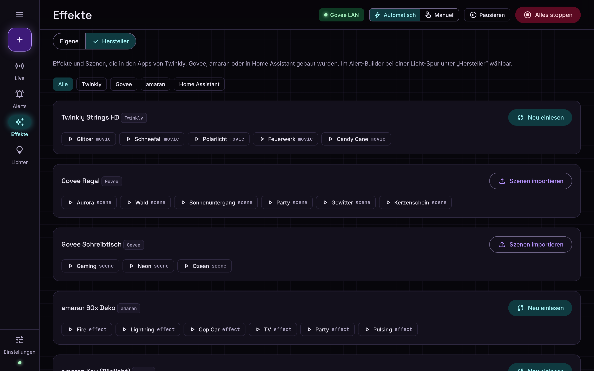</td>
<td><b>Lichter</b><br>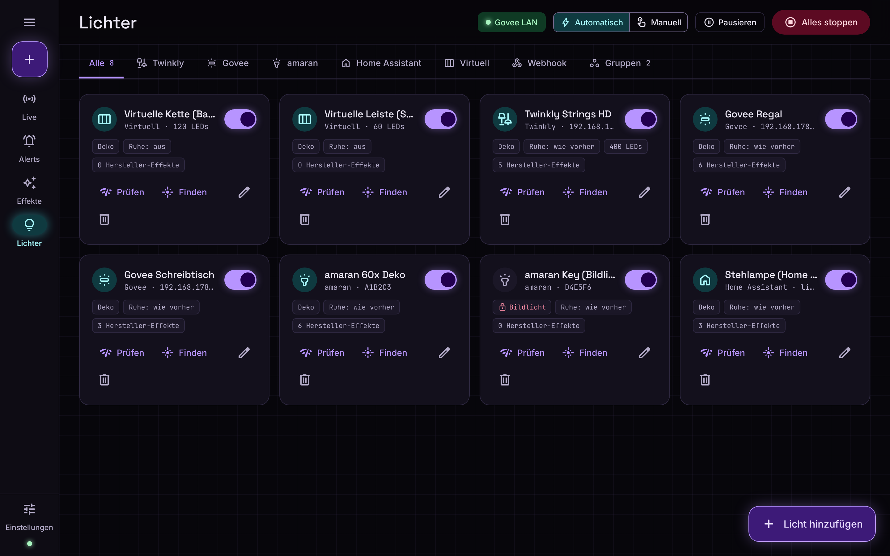</td>
</tr>
<tr>
<td colspan="2"><b>Einstellungen</b><br>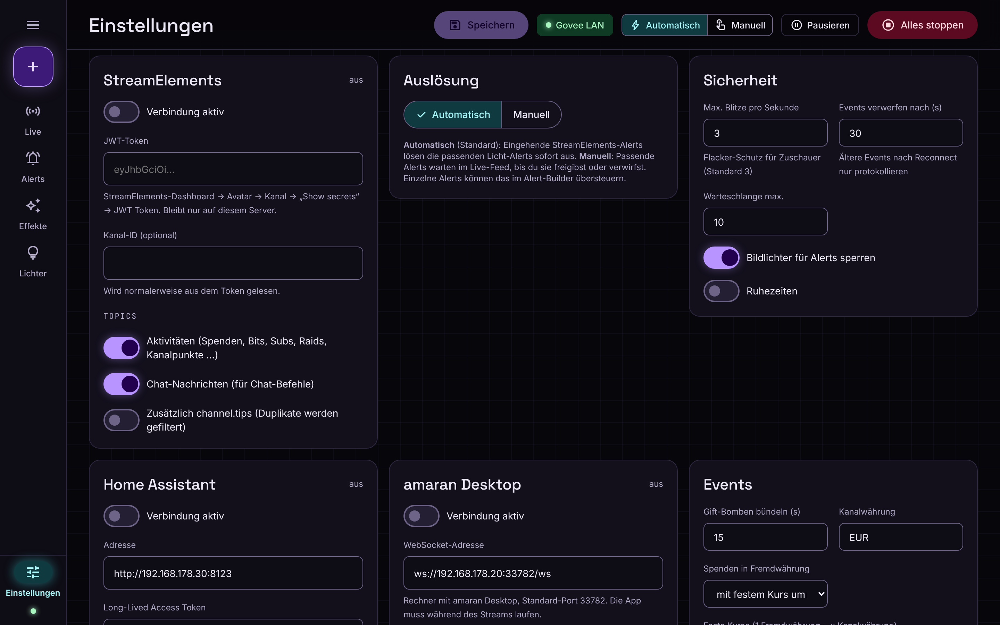</td>
</tr>
</table>

### Am Handy (PWA)

<p align="center">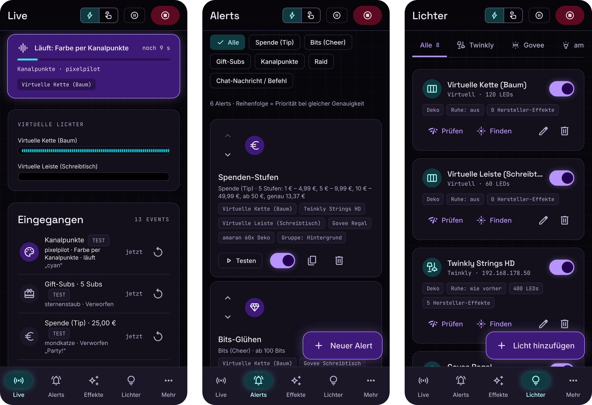</p>

> Alle Screenshots stammen aus dem Demo-Modus (`npm run demo`). Namen und Beträge sind Beispieldaten.

## 🔧 So funktioniert es

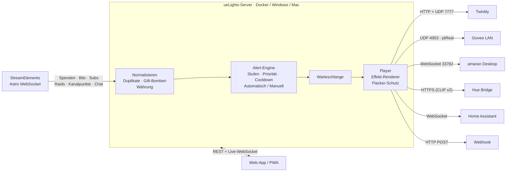

| Paket | Inhalt |
| --- | --- |
| [`packages/shared`](packages/shared) | Typen, Effekt-Renderer, Stufen- und Alert-Auswahl (läuft im Server **und** im Browser) |
| [`server`](server) | Fastify, StreamElements-Client, Engine, Konnektoren, JSON-Datenhaltung |
| [`web`](web) | React + Vite, Material 3 in Schwarz-Violett |

## 💡 Lichter einrichten

<details>
<summary><b>Twinkly</b> (z. B. Strings HD): lokale xled-API, Echtzeit pro LED</summary>

- Kette in der Twinkly-App ins WLAN bringen und die IP im Router fest reservieren.
- **Lichter → Licht hinzufügen → Twinkly → Suchen** oder die IP eintragen. **Prüfen** zeigt Modell, LED-Anzahl und RGB/RGBW.
- **Hersteller-Effekte:** Gewünschte Effekte in der Twinkly-App in die **Playlist** der Kette legen. Nur dann liegen sie auf dem Controller. Danach **Effekte → Hersteller → Neu einlesen**.
- Eigene Effekte laufen in Echtzeit (UDP 7777). Bei vertauschten Farben unter „Farbkanäle“ eine andere Reihenfolge wählen (RGBW-Ketten: `WRGB` oder `RGBW`).
- Schnelltest ohne ueLights: `curl http://<IP>/xled/v1/gestalt` muss JSON liefern.
- Die xled-API ist inoffiziell; Firmware-Updates können sie ändern.
</details>

<details>
<summary><b>Govee</b>: LAN-API, App-Szenen lokal per ptReal</summary>

- In der Govee-Home-App je Gerät **LAN Control** einschalten (nur Modelle von Govees LAN-Liste).
- UDP 4001 (Multicast), 4002 (Antwort) und 4003 (Befehle) müssen im Netz durchgehen. Port **4002** darf auf dem Host nicht belegt sein.
- Offiziell lokal steuerbar: an/aus, Helligkeit, Farbe. Eigene Effekte laufen als gedrosselte Farbfolge (Standard 5 Befehle/s).
- **App-Szenen:** Den Szenen-Katalog des Modells einmal als JSON besorgen und unter **Effekte → Hersteller → Szenen importieren** einfügen. Ausgelöst wird lokal, so wie es die Govee-App tut.

```jsonc
[{ "name": "Aurora", "sceneCode": 1234, "sceneParam": "<base64 optional>" }]                    // einfache Liste
{ "data": { "categories": [{ "scenes": [{ "sceneName": "Wald", "lightEffects": [{ "sceneCode": 99, "scenceParam": "AQI=" }] }] }] } } // Govee-Bibliothek
[{ "name": "DIY Blitz", "commands": ["<Base64, 20 Byte>", "…"] }]                                // mitgeschnittene Befehle
```

Snapshots aus der Govee-App liegen nur in Govees Cloud und sind lokal nicht erreichbar.
</details>

<details>
<summary><b>Philips Hue</b>: lokal über die Hue Bridge</summary>

- **Einstellungen → Philips Hue → Suchen** findet die Bridge im Netz (SSDP/mDNS, ohne Hue-Cloud). Alternativ die IP aus der Hue-App eintragen.
- **Runde Link-Taste** auf der Bridge drücken, dann innerhalb von 30 Sekunden **Koppeln**. ueLights merkt sich Schlüssel und Zertifikat der Bridge; meldet sich später ein anderes Gerät unter der Adresse, verweigert ueLights die Verbindung.
- **Alle Hue-Lampen übernehmen** legt jede Lampe als Licht an und je Raum eine Gruppe („Hue: Wohnzimmer“). Mehrfach ausführen ist unbedenklich, neue Lampen kommen dazu.
- Ganze **Räume, Zonen** oder „Alle Hue-Lampen“ gibt es unter *Lichter → Philips Hue → Suchen*. Ein Raum schaltet alle Lampen gleichzeitig, ist aber auf etwa einen Befehl pro Sekunde begrenzt; für schnelle Effekte besser einzelne Lampen nehmen.
- Szenen des Raums (statisch und dynamisch) und Lampen-Effekte (Kerze, Kaminfeuer, Funkeln …) stehen als Hersteller-Effekte bereit. Nach dem Alert stellt ueLights Farbe und Helligkeit jeder Lampe wieder her.
- Die Bridge verträgt etwa 10 Befehle pro Sekunde. ueLights fasst schnelle Farbwechsel zusammen, sodass immer der neueste Stand ankommt.
</details>

<details>
<summary><b>amaran / Aputure</b>: über die amaran-Desktop-App</summary>

- **amaran Desktop** (Mac/Windows) muss laufen. Die App hält die Bluetooth-Verbindung zu den Leuchten und öffnet einen lokalen WebSocket (Standard-Port **33782**).
- **Einstellungen → amaran Desktop:** `ws://<Rechner-IP>:33782/ws` eintragen, aktivieren. Läuft ueLights unter Windows auf demselben PC, genügt `ws://localhost:33782/ws`.
- **OpenAPI-Key** (amaran Desktop → Benutzerzentrum → OpenAPI beantragen) unter *Einstellungen → amaran Desktop* eintragen oder per `AMARAN_API_KEY` setzen. Der Key bleibt in ueLights; er signiert jede Anfrage über denselben lokalen WebSocket (AES-256-GCM-Token, Protokoll v2). Ältere Desktop-Versionen ohne Key-Prüfung werden automatisch erkannt.
- **Lichter → amaran → Suchen** listet die Leuchten. Eingebaute Effekte, Presets, Quickshots und Szenen werden eingelesen.
- **Bi-Color-Leuchten** (z. B. Halo 60x, Verge, COB 60x S) können keine Farben. ueLights erkennt sie am Modellnamen (oder an der Ablehnung eines Farbbefehls) und macht aus Farben Weißtöne: warme Farben → 2700 K, Weiß → 5600 K, kalte Farben → 6500 K. Helligkeit, Blitze und Pulse bleiben erhalten. Pro Licht unter *Farbfähigkeit* auch fest einstellbar.
- Befehlsnamen für Presets und Szenen sowie die Intensitäts-Skala sind unter *Erweitert* einstellbar.
- Leuchten, die im Bild ausleuchten, als **Bildlicht** markieren. Alerts schalten sie dann nie.
</details>

<details>
<summary><b>Home Assistant</b>: Lichter, Effekte, Szenen und Skripte</summary>

- Home Assistant → Profil → Sicherheit → **Langlebiges Zugriffstoken** erstellen.
- **Einstellungen → Home Assistant:** Adresse (`http://<IP>:8123`) und Token eintragen, aktivieren.
- **Lichter → Home Assistant → Suchen** listet `light.*`, `scene.*` und `script.*`. Die `effect_list` jedes Lichts erscheint als Hersteller-Effekte, z. B. alle Govee-Szenen über die HACS-Integration *Govee Local Plus*.
- Ein Licht entweder direkt oder über Home Assistant anlegen, nicht beides.
</details>

<details>
<summary><b>Virtuell & Webhook</b></summary>

- **Virtuell:** LED-Streifen auf der Live-Seite, ideal zum Bauen und Testen ohne Hardware.
- **Webhook:** `POST` mit JSON (`type: alert | color | restore | off`, Event-Daten) an eine lokale Adresse, z. B. Node-RED.
</details>

## 🪜 Beispiel: Spenden-Stufen in 2 Minuten

1. **Alerts → Neuer Alert**, Trigger **Spende (Tip)**, **Stufen nach Betrag**.
2. Stufen anlegen: `1–4,99 €` · `5–9,99 €` · `10–49,99 €` · `ab 50 €`. Optional ein Easter Egg mit `genau 13,37 €`.
3. Je Stufe **Licht hinzufügen** und einen Effekt wählen: eigener Effekt, Hersteller-Effekt oder „Farbe aus Nachricht“.
4. **Testen** spielt die gewählte Stufe sofort ab, **Speichern**. Ab jetzt löst jede eingehende Spende automatisch die passende Stufe aus.

Passen mehrere Alerts auf ein Event, gewinnt der spezifischste (exakt › Bereich › ab › jeder Betrag), bei Gleichstand der weiter oben in der Liste. Alerts mit „Immer zusätzlich ausführen“ laufen mit.

## 🐳 Betrieb

<details>
<summary><b>Docker / Synology DSM</b></summary>

```yaml
services:
  uelights:
    build: .
    restart: unless-stopped
    network_mode: host        # für die Gerätesuche (Broadcast/Multicast) und Govee-Port 4002
    environment:
      - TZ=Europe/Berlin
    volumes:
      - ./data:/data
```

Von unterwegs z. B. per Tailscale erreichbar.
</details>

<a id="synology-aufgabenplaner"></a>
<details open>
<summary><b>Synology: automatisch installieren und aktuell halten (Aufgabenplaner)</b></summary>

Eine einzige geplante Aufgabe installiert ueLights beim ersten Lauf und hält es danach aktuell. Git und SSH sind nicht nötig, nur der **Container Manager** (Paketzentrum).

1. **File Station:** Ordner `docker/uelights` anlegen (liegt dann unter `/volume1/docker/uelights`).
2. **Systemsteuerung → Aufgabenplaner → Erstellen → Geplante Aufgabe → Benutzerdefiniertes Skript**
   - *Allgemein:* Name `ueLights Update`, Benutzer **root**
   - *Zeitplan:* täglich, z. B. 05:00 Uhr (oder stündlich, ein Lauf ohne neue Version dauert nur eine Sekunde)
   - *Aufgabeneinstellungen:* „Ausführungsdetails per E-Mail senden“ und „nur wenn das Skript abnormal beendet wird“ aktivieren
   - *Benutzerdefiniertes Skript:*
     ```bash
     BASE=/volume1/docker/uelights
     mkdir -p "$BASE"
     [ -f "$BASE/uelights-update.sh" ] || curl -fsSL https://raw.githubusercontent.com/Intracy/ueLights/main/nas/uelights-update.sh -o "$BASE/uelights-update.sh"
     bash "$BASE/uelights-update.sh"
     ```
3. Aufgabe markieren → **Ausführen**. Der erste Lauf baut das Image (je nach NAS 3 bis 10 Minuten), danach läuft ueLights unter `http://<NAS-IP>:8787` und startet mit dem NAS automatisch.

Was das Skript bei jedem Lauf macht:

- Es fragt bei GitHub den neuesten Stand von `main` ab. Ist nichts neu und der Container läuft, endet es sofort.
- Gibt es etwas Neues, lädt es den Quellcode, baut das Image und startet den Container neu. Läuft danach nach 90 Sekunden kein Health-Check durch, **stellt es automatisch die vorige Version** samt Einstellungen wieder her und meldet sich per E-Mail. Ein fehlgeschlagener Build lässt die laufende Version unangetastet.
- Läuft der Container nicht (z. B. von Hand gestoppt), startet es ihn wieder.
- Das Skript aktualisiert sich selbst mit.

Im Ordner liegen danach `data/` (Einstellungen, bleibt immer erhalten), `.env` (Port und optionale Tokens), `docker-compose.yml`, `app/` (aktuelle Version) und `logs/update.log`. Der Container erscheint im Container Manager als Projekt **uelights**. Sofort aktualisieren: Aufgabe ausführen. Neu bauen erzwingen: im Skript `bash "$BASE/uelights-update.sh" --force`.

Hinweis: Das Skript lädt als root Code aus diesem Repository. Wer Updates lieber selbst freigibt, stellt die Aufgabe auf „deaktiviert“ und führt sie nur bei Bedarf von Hand aus.
</details>

<details>
<summary><b>Windows</b></summary>

**`ueLights.exe`** (aus den [Releases](https://github.com/Intracy/ueLights/releases)) enthält Server, Web-App und Node.js in einer Datei. Doppelklick startet ueLights und öffnet den Browser; läuft es schon, öffnet ein zweiter Doppelklick nur den Browser. Das Fenster zeigt den Status, Schließen beendet ueLights. Die Datei ist nicht signiert: Bei SmartScreen „Weitere Informationen → Trotzdem ausführen“ wählen. Für den Autostart eine Verknüpfung in `shell:startup` legen. Selbst bauen: `npm run build:exe` auf einem Windows-Rechner.

Alternativ die Skripte im Repo (Node.js wird bei Bedarf über winget installiert):

| Skript | Zweck |
| --- | --- |
| `ueLights-starten.bat` | Start im Fenster (`-Port 8788`, `-Rebuild`, `-NoBrowser`) |
| `windows\autostart-einrichten.ps1` | Unsichtbarer Start bei der Anmeldung mit Neustart nach Absturz; `-Firewall` (als Admin) legt Regeln für TCP 8787 und UDP 4002 an |
| `windows\autostart-entfernen.ps1` | Autostart entfernen, Hintergrund-Server beenden |
| `windows\update.ps1` | `git pull`, neu bauen, Autostart neu starten |

Daten liegen in `%LOCALAPPDATA%\ueLights`, Logs unter `…\ueLights\logs\uelights.log`.
</details>

<details>
<summary><b>macOS</b></summary>

```bash
git clone https://github.com/Intracy/ueLights.git && cd ueLights
./ueLights-starten.command
```

Oder im Finder **`ueLights-starten.command`** doppelklicken. Das Skript prüft Node.js (bietet bei Bedarf die Installation über Homebrew an, sonst den Installer von nodejs.org), installiert die Abhängigkeiten, baut beim ersten Start und nach Änderungen und öffnet den Browser. Läuft ueLights schon, öffnet ein weiterer Doppelklick nur den Browser. Beim ersten Gerätesuchen fragt macOS nach dem **Zugriff auf Geräte im lokalen Netzwerk**: erlauben, sonst findet ueLights Twinkly und Govee nicht (nachträglich unter *Systemeinstellungen → Datenschutz & Sicherheit → Lokales Netzwerk*). Als ZIP geladen meldet macOS evtl. „nicht verifizierter Entwickler“: Rechtsklick → *Öffnen* oder `bash ueLights-starten.command` im Terminal.

| Skript | Zweck |
| --- | --- |
| `ueLights-starten.command` | Start im Terminal-Fenster (`--port 8788`, `--rebuild`, `--no-browser`) |
| `mac/autostart-einrichten.sh` | Start bei der Anmeldung im Hintergrund (LaunchAgent, Neustart nach Absturz) |
| `mac/autostart-entfernen.sh` | Autostart entfernen, Hintergrund-Server beenden |
| `mac/update.sh` | `git pull`, neu bauen, Autostart neu starten |

Daten liegen in `~/Library/Application Support/ueLights`, Logs unter `~/Library/Logs/ueLights/`. Die amaran-Desktop-App läuft auf demselben Mac: `ws://localhost:33782/ws`.
</details>

<details>
<summary><b>Umgebungsvariablen</b></summary>

| Variable | Standard | Bedeutung |
| --- | --- | --- |
| `PORT` | `8787` | Port der Web-App |
| `DATA_DIR` | `./data` (`/data` im Container) | Einstellungen, Alerts, Protokoll |
| `UELIGHTS_PASSWORD` | – | Passwort fest vorgeben |
| `SE_JWT` | – | StreamElements-Token |
| `HA_TOKEN` | – | Home-Assistant-Token |
| `AMARAN_API_KEY` | – | amaran-OpenAPI-Key |
| `UELIGHTS_DISABLE_AUTH` | `0` | Login abschalten (nur für Tests) |
| `LOG_LEVEL` | `info` | `debug` für mehr Ausgabe |
</details>

<details>
<summary><b>REST- & Live-API</b></summary>

Alle Endpunkte liegen unter `/api`, Anmeldung per Session-Cookie.

| Methode | Pfad | Zweck |
| --- | --- | --- |
| `GET` | `/api/bootstrap` | Alle Daten für die Web-App |
| `POST/PUT/DELETE` | `/api/alerts` · `/api/effects` · `/api/lights` · `/api/groups` | Verwalten; `PUT /api/alerts` mit einer Liste setzt die Reihenfolge |
| `POST` | `/api/alerts/:id/fire` | Alert oder Stufe testen (`{ tierId, amount }`) |
| `POST` | `/api/test-event` | Testevent (`{ type, amount, message, reward }`) |
| `POST` | `/api/trigger-mode` | `{ mode: "auto" \| "manual" }` |
| `POST` | `/api/events/:id/release` · `/dismiss` · `/api/pending/release-all` | Manuelle Alerts freigeben oder verwerfen |
| `POST` | `/api/stop` · `/api/pause` | Alles stoppen · Pause |
| `POST` | `/api/lights/:id/natives/refresh` · `/import` | Hersteller-Effekte einlesen oder importieren |
| `GET` | `/api/discover/{twinkly,govee,homeassistant,amaran}` | Geräte finden |
| `GET/POST` | `/api/export` · `/api/import` | Sicherung |
| `WS` | `/api/live` | Live-Events, Status, virtuelle LEDs |
</details>

## 🔒 Datenschutz & Sicherheit

- Das StreamElements-Token liegt nur in `data/store.json` auf deinem Rechner (Dateirechte 600) und wird nie an den Browser zurückgegeben.
- Die Lichter werden ausschließlich im lokalen Netz angesprochen. Einzige Ausnahme: Der Govee-Szenen-Katalog wird einmalig von dir importiert.
- Login mit Passwort (scrypt), Session-Cookie mit `httpOnly` und `SameSite=strict`.
- Der Flacker-Schutz begrenzt Strobe-, Puls- und Farbwechsel-Effekte standardmäßig auf 3 Blitze pro Sekunde, angelehnt an gängige Empfehlungen zur Photosensibilität.

## 🧪 Entwicklung

```bash
npm install
npm run dev         # Server :8787 mit Auto-Reload + Vite :5173 mit Proxy
npm test            # Vitest: Stufen, Effekte, Flacker-Schutz, Normalisierung, Gift-Bündelung, Govee-Kodierung, Automatisch/Manuell
npm run typecheck
npm run build
```

## ⚠️ Bekannte Grenzen

- **StreamElements-Felder** unterscheiden sich je Plattform leicht. ueLights liest sie defensiv aus; das Rohformat jedes Events steht in `data/events.json`.
- **Twinkly Strings HD** ist in der xled-Doku nicht getestet. Vor dem ersten Einsatz „Prüfen“ und einen Effekt testen.
- **amaran:** Das Key-Format (Hex, Base64 oder Text) ist nicht öffentlich dokumentiert; ueLights akzeptiert alle drei. Lehnt die Desktop-App den Key ab, zeigt die Statuszeile „API-Key abgelehnt“. Der Befehl für Szenen ist konfigurierbar.
- **Govee-Szenen mit Parametern** sind inoffiziell umgesetzt.
- **Philips Hue** läuft über normale Befehle, nicht über die Entertainment-API. Pro-LED-Effekte wie bei Twinkly gibt es dort deshalb nicht, dafür braucht es keinen Entertainment-Bereich.
- Sitzungen liegen im Speicher; nach einem Neustart des Servers einmal neu anmelden.

## 🗺️ Roadmap

- [ ] API-Schlüssel für Stream Deck / Companion (`POST /api/alerts/:id/fire` ohne Login)
- [ ] Weitere Trigger-Quellen: OBS-Szenenwechsel (obs-websocket), eingehende Webhooks (FF-Overlay, betterplace)
- [ ] MQTT-Konnektor
- [ ] Räumliche Twinkly-Effekte aus dem gemappten Layout
- [ ] Spendenziele und Hype-Train als dauerhafte Füllstandsanzeige
- [ ] Zeitleiste und Alert-Reihenfolge per Drag & Drop
- [ ] Undo/Versionen, Statistik je Alert und Gerät
- [ ] Warteschlange je Gerät (parallele Alerts auf verschiedenen Lichtern)

## 📄 Lizenz

[MIT](LICENSE) © Tobias Lindner
